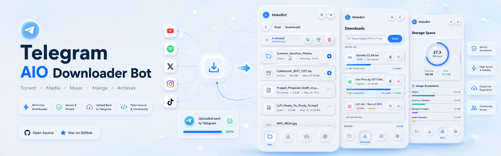

# Telegram AIO Downloader Bot

An asynchronous Telegram bot and Mini App for downloading, organizing, processing, and uploading media and files from a VPS.

> Use this project only for content you are authorized to access. It does not bypass DRM, paid access, private-content restrictions, or copyright law.

## Features

- Torrent and magnet downloads through `aria2c`
- Direct HTTP/HTTPS file downloads with resume support
- YouTube and social-media video or audio downloads through `yt-dlp`
- Spotify tracks, albums, playlists, artists, shows, and episodes through `spotDL`
- Manga and image-gallery downloads with optional PDF conversion
- Hundreds of image sites (Pixiv, boorus, Imgur, Reddit galleries, …) through `gallery-dl`
- ZIP and 7Z creation, password protection, and volume splitting
- Upload files and folders to Telegram Saved Messages through Pyrogram, or to a channel/group you choose in Settings
- Sequential batch processing with download-only or upload-and-delete modes
- One live card per download: progress, speed and ETA, Pause/Cancel, then Upload / Open / Delete or Retry
- Video quality picker (Best, 1080p/720p/480p caps, MP3, GIF) or a default quality
- GIFs come back as GIFs: short silent clips (X/Twitter and Reddit GIFs, Imgur, …) are sent to the chat as Telegram GIFs
- GIF previews: one tap on a finished video's card (or its file card) sends ONE preview video made of 10 six-second clips spread across the video, captioned with each clip's timestamp; auto-uploaded videos get it automatically in the same chat as the upload
- Optional [cobalt](https://github.com/imputnet/cobalt) instance as a second engine when yt-dlp fails
- Page finder: links nothing else understands are opened in headless Chromium, the player is started automatically, and the HLS/DASH stream it loads is downloaded
- Cookies (for YouTube's "confirm you're not a bot", private or age-restricted videos) can be sent to the bot as a file
- Optional automatic upload to Saved Messages when a download finishes
- Unified torrent search across Prowlarr, The Pirate Bay and RARBG mirrors
- File browser where every file is a button: Recent downloads first, Find, sort, and a card per file with Send here / Saved Messages / Zip / Rename / Delete
- The job list survives restarts; torrent and direct downloads resume
- Telegram Mini App for downloads, files, storage, uploads, archives, and settings

See [Supported Sites](docs/SUPPORTED_SITES.md) for the complete provider list and current limitations.

## Mainstream Media Support

| Platform | Video | Audio |
|---|---:|---:|
| YouTube | Yes | Yes |
| TikTok | Yes | Yes |
| Instagram | Yes | Yes |
| X / Twitter | Yes | Yes |
| Facebook | Yes | Yes |
| Vimeo, Dailymotion, and Twitch | Yes | Yes |
| Spotify | Music and podcasts | Yes |

## Common Inputs

| Input | Handler |
|---|---|
| Magnet or `.torrent` file | aria2 torrent downloader |
| Direct file URL | aria2 HTTP downloader |
| YouTube or supported social-media URL | yt-dlp video/audio downloader |
| Spotify URL | spotDL audio downloader |
| Manga or gallery URL | Gallery downloader |
| Other image/gallery site URL | `gallery-dl` (when it recognises the site) |
| Supported playlist or profile URL | Sequential batch downloader |

## Quick Start

### Ubuntu

```bash
git clone https://github.com/cyanologyst/Telegram-Aio-Downloader.git
cd Telegram-Aio-Downloader
bash scripts/setup_ubuntu.sh
```

The setup script installs system tools, creates `.venv`, installs Python dependencies, writes `.env`, and optionally configures Prowlarr.

Start the bot:

```bash
source .venv/bin/activate
python main.py
```

For a Mini App without a permanent HTTPS domain:

```bash
bash scripts/start_with_cloudflare_tunnel.sh
```

### Manual Setup

```bash
python -m venv .venv
source .venv/bin/activate
pip install -r requirements.txt
cp .env.example .env
python main.py
```

On Windows, activate the environment with:

```powershell
.\.venv\Scripts\Activate.ps1
```

## Configuration

Required values in `.env`:

```dotenv
BOT_TOKEN=
API_ID=
API_HASH=
ALLOWED_USER_IDS=123456789
```

`API_ID`/`API_HASH` and a one-time Pyrogram login (the first `python main.py` in a terminal asks for your phone number and code) let the bot upload files of any size to your Saved Messages. Without them it runs in bot-only mode: files up to 50 MB are sent to the chat, and forwarded-media capture is off.

**Upload to a channel or group.** In **⚙️ Settings → 📍 Upload to**, tap *Set upload target* and send `@channelname`, a `t.me/…` link or a numeric id like `-1001234567890` (or forward a text post from it). The bot checks that your account can post there — an admin with "post messages" in a channel, or a member of a group — and then every upload (Upload buttons, "Upload when done", playlist upload-and-delete) goes there instead of Saved Messages. Files over 2 GB are still split into parts. In bot-only mode the bot itself must be an admin there, and files are limited to 50 MB. *Reset to Saved Messages* undoes it. GIFs and "Send here" still come to the bot chat.

**GIF previews.** A finished video's card and the video's file card have a **🎞 GIF previews (10×6s)** button. It cuts 10 six-second clips evenly spread over the video (480 px, 12 fps, silent) and joins them in timeline order into one video, `Preview - <name>.mp4`, captioned `Preview - <name>` with a chapter line per clip like `Preview 3/10 @ 12:34`. After an automatic upload the preview is posted right after the video, in the same chat (Saved Messages or the upload channel/group). If ffmpeg can't join the clips they go out as one album instead. Videos shorter than a minute get fewer clips; needs `ffmpeg` and `ffprobe`.

`ALLOWED_USER_IDS` is your numeric Telegram user ID (message @userinfobot to find it). The bot refuses to start without it, and silently ignores everyone else.

Common optional settings:

| Variable | Purpose |
|---|---|
| `PYRO_SESSION_NAME` | Pyrogram session used for Telegram uploads |
| `YTDLP_COOKIES_FILE` | Netscape cookies file; needed when YouTube says "confirm you're not a bot" (common on VPS IPs) and for private or age-restricted videos. Easier: send the file to the bot in **⚙️ Settings → 🍪 Cookies** |
| `YTDLP_PROXY` | Optional proxy for yt-dlp and spotDL |
| `COBALT_API_URL` / `COBALT_API_KEY` | Your own [cobalt](https://github.com/imputnet/cobalt) instance, tried when yt-dlp fails (see below) |
| `PAGE_FINDER` / `PAGE_FINDER_TIMEOUT` | The page finder (`auto` or `off`), and how many seconds it waits for the player (see below) |
| `PAGE_FINDER_ADBLOCK` / `ADBLOCK_LISTS` | Ad blocking in the page finder's browser (`on`/`off`) and its filter lists (default EasyList) |
| `DENO_BIN` | Absolute Deno path when required by a provider |
| `PROWLARR_URL` / `PROWLARR_API_KEY` | Prowlarr torrent search |
| `TPB_API_URL` / `RARBG_BASE_URL` | Torrent-search endpoints |
| `WEB_APP_URL` | Public HTTPS URL for the Telegram Mini App |
| `SUPPORTED_SITES_URL` | URL opened by the bot's Supported Sites button |

See [.env.example](.env.example) for all available settings.

### YouTube and Spotify on a VPS

YouTube refuses many datacenter IPs with "Sign in to confirm you're not a bot". Spotify links are affected too, because spotDL takes the audio from YouTube. The fix is cookies from a logged-in browser:

1. Use a spare Google account, open a private window and log in to youtube.com.
2. Export cookies with the "Get cookies.txt LOCALLY" extension (Netscape format), then close the window.
3. In the bot, open **⚙️ Settings → 🍪 Cookies → Send cookies.txt** and send the file.

The bot deletes your message, stores the file in `data/cookies.txt` (mode 600), and uses it for yt-dlp, spotDL and gallery-dl. A residential proxy in `YTDLP_PROXY` is the alternative.

### cobalt (optional)

[cobalt](https://github.com/imputnet/cobalt) is a second engine for X/Twitter, Instagram, TikTok, Reddit, YouTube and more. When `COBALT_API_URL` is set and yt-dlp fails, the bot asks cobalt instead (the card says "via cobalt"). Public instances such as `api.cobalt.tools` are bot-protected and not for other apps, so run your own next to the bot:

```yaml
# docker-compose.yml
services:
  cobalt:
    image: ghcr.io/imputnet/cobalt:11
    restart: unless-stopped
    ports:
      - "127.0.0.1:9000:9000"
    environment:
      API_URL: "http://127.0.0.1:9000/"
```

```dotenv
COBALT_API_URL=http://127.0.0.1:9000/
```

cobalt reaches YouTube through its own client but is subject to the same IP blocks.

### Page finder

Many streaming sites only reveal their video link once the player starts. For links nothing else understands, and for video sites where yt-dlp (and cobalt) fail, the bot opens the page in headless Chromium, presses the player's play button itself, and watches the network the way a video-grabber browser extension does:

- HLS (`.m3u8`) and DASH (`.mpd`) playlists and direct video files are detected, including ones in embedded players from other sites and ones fetched by service workers;
- the headers the player sent (its own Referer, cookies, signature headers) are replayed for the download, and the playlist text is reused because such links often work only once;
- the main video is picked (the longest, highest-quality stream) and the usual quality picker appears; **🎞 Other videos** lists trailers and previews found on the same page;
- DRM-protected streams are refused;
- ads are blocked in that browser (Brave's ad-block engine with EasyList, downloaded to `data/adblock/` and refreshed weekly), pop-up windows are suppressed, and "tab-under" redirects (a click that sends the tab to an ad site) are stopped, so the click starts the player. Ad videos that still load are recognised and never offered as the video. `PAGE_FINDER_ADBLOCK=off` turns the blocking off; `ADBLOCK_LISTS` sets other filter lists.

yt-dlp then downloads the stream (qualities, AES-128 decryption, merging). Cookies from Settings → Cookies are loaded into the browser for age gates and logins.

It needs Chromium: `setup_ubuntu.sh` installs it, or run `python -m playwright install --with-deps chromium` in the bot's venv. Opening a page takes 5–30 seconds and a few hundred MB of RAM, so only one page is opened at a time. Sites behind a "verify you are human" challenge and YouTube can't be read this way. Set `PAGE_FINDER=off` to turn it off.

## Using the Bot

- **Send a link** (magnet, `.torrent` file, direct file, video, Spotify, manga or gallery) to start a download. Each download gets its own card with live progress.
- **GIFs**: short clips without sound (up to a minute) and `.gif` files are sent to the chat as Telegram GIFs when the download finishes; pick **🎞 GIF** in the quality picker to make one from any short video. Turn it off in Settings → GIFs to chat.
- The keyboard has **📊 Status**, **📁 Files**, **🔍 Search**, **⚙️ Settings**, **🏠 Menu** and **❓ Help**.
- `/cancel` stops whatever the bot is waiting for you to type. The `/` menu lists every command.

## Updating

```bash
git pull
source .venv/bin/activate
pip uninstall -y pyrogram   # one-time: replaced by Kurigram, which uses the same package name
pip install -U -r requirements.txt
python main.py
```

Your existing Pyrogram `.session` file keeps working after the switch to Kurigram.

Restart your systemd, PM2, Docker, or other process manager after the dependency update.

## Development

```bash
pip install -r requirements/dev.txt
ruff check app tests
black --check app tests
isort --check-only app tests
mypy app
pytest
```

Project documentation:

- [Architecture](docs/architecture.md)
- [Development Guide](docs/development.md)
- [Extension Guide](docs/extension-guide.md)
- [Mini App Guide](docs/miniapp-guide.md)
- [Supported Sites](docs/SUPPORTED_SITES.md)
- [Contributing](CONTRIBUTING.md)

## License

See [LICENSE](LICENSE).
